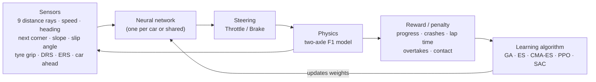

<div align="center">

# RL Racing Lab

### Cars that teach themselves to race, with nothing but reward and penalty.

No driving code. No racing line. No hand-written rules.<br>
Hundreds of neural-network drivers start out crashing at random and learn, generation after generation, to lap real Formula 1 circuits.

[](LICENSE)
[](package.json)
[](https://nodejs.org)
[](https://threejs.org)
[](tests)
[](#quick-start)

**English** · [Türkçe](README.tr.md)


</div>

<br>

<table>
<tr>
<td width="50%" valign="top">
<br>
<b>Train up to 2000 cars at once.</b> Genetic algorithms, evolution strategies, CMA-ES, PPO and SAC, live in your browser, spread across all CPU cores.
</td>
<td width="50%" valign="top">
<br>
<b>Ride along in 3D.</b> Pause training at any moment and watch the fastest lap from the cockpit, with engine sound, telemetry and a real F1 lap as a ghost.
</td>
</tr>
<tr>
<td width="50%" valign="top">
<br>
<b>Make them race each other.</b> In race mode, cars start from a grid, see each other, collide, and get rewarded for overtaking.
</td>
<td width="50%" valign="top">
<br>
<b>Analyse like an engineer.</b> Speed, throttle, brake, gear, g-forces, tyre temperature, sectors, mini-sectors and delta time against another lap.
</td>
</tr>
</table>

> [!NOTE]
> The app's interface is in **Turkish**. Everything else (code structure, CLI, data formats) is easy to follow, and this README explains every feature.

## Quick start

Requires only [Node.js](https://nodejs.org) 18 or newer. Nothing to install: no `npm install`, no build step.

```bash
git clone https://github.com/YucelFuat/f1-reinforcement-learning.git
cd f1-reinforcement-learning
node server.js
```

Then open **http://localhost:5180**. Training starts immediately.

On Windows you can also double-click **`Baslat.cmd`**. It starts the server and opens the app in its own window. The app can also be installed as a desktop app (PWA) from the browser.

## The training view

<p align="center"></p>

Cars on the track, the crash heat-map, the previous champion's line, sector times, the ideal lap, the top-5 drives, learning curves and the live neural network of the selected car.

## How it works



Every car only ever sees what its sensors report and only ever learns from the reward it collects. It is never told where the racing line is, when to brake or how to take a corner. Whatever driving style appears, the algorithm discovered on its own.

## Features

<table>
<tr><td valign="top" width="50%">

**Learning**
- 6 algorithms behind one plug-in registry
- 50 to 2000 cars, multi-core via Web Workers + SharedArrayBuffer
- Random "flying" starts anywhere on the lap, so hard corners get practised far more often
- **Auto-tuner:** when progress stalls, it tries a hyper-parameter or reward change and keeps it only if a reward-independent score improves
- Reproducible runs: same seed + same settings = same training
- Automatic save and resume after a reload

</td><td valign="top" width="50%">

**Simulation**
- Two-axle physics with load transfer, tyre load sensitivity, understeer, oversteer and spins
- Tyre temperature, wear and three compounds; fuel mass and burn
- ERS (120 kW, 4 MJ) and automatic DRS zones
- Pit-stop strategy for multi-lap races
- Race mode: heats, grid starts, car-to-car contact, overtakes
- Real elevation: climbs help braking, crests make it harder

</td></tr>
<tr><td valign="top">

**Analysis**
- Sector and ideal-lap tracking during training
- Telemetry with every channel, mini-sector colour coding and per-lap tables
- Delta-time against previous records, the top-5 drives, real F1 laps or your own CSV
- Experiment manager: save runs, overlay their learning curves, diff their settings
- One-click ZIP export: CSV telemetry, charts, settings, the brain itself

</td><td valign="top">

**3D replay**
- Blender-modelled car with spinning wheels and live steering
- Grandstands, crowds, sponsor bridges, pit building, Austin's tower
- Bloom, ambient occlusion, motion blur
- Six cameras, synthesized engine sound
- Top-5 and race-heat replays with labels and standings
- Ghost car of a real F1 lap

</td></tr>
</table>

## Algorithms

| Algorithm | Kind | Idea |
|---|---|---|
| **Genetic Algorithm** | population | Every car has its own network. The best survive, the rest are bred by neuron-wise crossover and mutation. |
| **OpenAI-ES** | population | One shared weight vector. Each car drives a noisy copy, and the vector moves towards the noise that scored best. |
| **sep-CMA-ES** | population | Like ES, but it also learns how wide to search in every weight direction. |
| **PPO (discrete)** | per step | One shared actor-critic policy, 9 discrete actions, updated in a background worker. |
| **PPO (continuous)** | per step | Gaussian policy over steering and throttle, with observation and reward normalisation. The fastest learner in our benchmarks. |
| **SAC** | per step | Off-policy soft actor-critic: twin Q networks, replay buffer and automatic entropy tuning. |

<details>
<summary><b>Benchmark</b> (kidney-shaped test track, headless, 2-core container)</summary>
<br>

| Algorithm | Cars | First finished lap | Best lap |
|---|---|---|---|
| Genetic Algorithm | 300 | generation 14–18 | 26.9–28.0 s |
| sep-CMA-ES | 300 | generation 8–19 | 27.7–28.9 s |
| PPO (discrete) | 128 | none in 300 updates | – |
| **PPO (continuous)** | 128 | **after 7–34 s** | **25.8–25.9 s** |
| SAC | 128 | after 40–189 s | 27.2–30.6 s |

Ranges are over three seeds. Run your own with `node tools/algo-bench.js`.

</details>

Adding your own algorithm means adding one entry to [`src/algos/index.js`](src/algos/index.js). The UI builds its sliders from the entry automatically.

## Physics

The "real F1 physics" preset is calibrated to a 2019–2025 era car:

| | |
|---|---|
| Mass | 798 kg + fuel |
| Power | 750 kW (630 kW V6 turbo + 120 kW ERS) |
| Drag / downforce | CdA 1.45 m² / ClA 4.4 m² |
| Weight / aero balance | 45 % / 42 % front |
| **Top speed** | **~341 km/h** (~360 km/h with DRS) |
| **Braking 300 → 0 km/h** | **~103 m, 3.1 s** |
| **Cornering** | **~5.3 g fast, ~2.1 g slow** |

Front and rear axles each have their own friction circle. Braking shifts load forwards and accelerating shifts it backwards, and tyre grip falls as load rises. Push the front past its limit and the car understeers. Push the rear past its limit and the nose keeps turning while the slip angle grows; beyond ~31° the car spins. Every parameter has a slider, and there is an "easy mode" for faster learning.

## Tracks

| Circuit | Length | Real-world reference lap |
|---|---|---|
| Circuit of the Americas, Austin | 5.513 km | 1:36.169, Leclerc 2019 |
| İstanbul Park | 5.338 km | 1:24.770, Montoya 2005 |
| Monza | 5.793 km | 1:20.901, Norris 2025 |
| Spa-Francorchamps | 7.004 km | 1:44.701, Pérez 2024 |
| Silverstone | 5.891 km | 1:27.097, Verstappen 2020 |

The real circuits include their actual elevation profiles. There are also four fictional tracks, a random track generator and a track editor. Corners, sectors and DRS zones are detected automatically.

<p align="center"></p>

### Compare against real F1 laps

Every real circuit ships with one real race lap (speed, throttle, brake, gear, rpm against distance). In the 3D replay that lap drives alongside yours as a ghost car, and its traces overlay your telemetry with a delta-time chart.

You can also bring any lap you like. [`tools/fastf1_export.py`](tools/fastf1_export.py) uses [FastF1](https://github.com/theOehrly/Fast-F1) to export any driver's lap to a CSV that the replay screen imports:

```bash
pip install fastf1
python tools/fastf1_export.py --yil 2024 --etkinlik Monza --oturum Q --surucu LEC
```

## What a car sees

25 inputs per car, all normalised:

| Inputs | |
|---|---|
| 9 | Distance rays from −90° to +90° (200 m); in race mode they see other cars too |
| 2 | Speed, heading error relative to the track |
| 4 | Track direction 35 / 90 / 170 / 280 m ahead |
| 3 | Lateral position, distance to the next apex, sharpness of the next corner |
| 3 | Slope, body slip angle, tyre grip (temperature × wear × compound) |
| 2 | DRS open, ERS charge |
| 2 | Gap to the car ahead and its lateral offset (race mode) |

Outputs: steering and throttle/brake (continuous), or 9 discrete actions for discrete PPO.

## Command line

Train without a browser, as fast as the CPU allows:

```bash
node tools/headless.js --algo ppoc --cars 128 --track kidney --updates 300
node tools/headless.js --algo ga --cars 300 --track austin --gens 200 --spawn mixed --out beyin.json
```

Load the resulting `beyin.json` ("brain") in the app with "JSON yükle".

<details>
<summary>All options</summary>

| Option | Values |
|---|---|
| `--algo` | `ga` · `es` · `cmaes` · `ppo` · `ppoc` · `sac` |
| `--track` | `oval` · `kidney` · `technical` · `gp` · `austin` · `istanbul` · `monza` · `spa` · `silverstone` |
| `--cars`, `--gens`, `--updates`, `--seed`, `--laps` | numbers |
| `--spawn` | `start` · `mixed` · `random` |
| `--mode`, `--heat` | `solo` · `race`, heat size |
| `--compound` | `soft` · `medium` · `hard` |
| `--tyre`, `--wear`, `--ers` | `0` · `1` |
| `--drs` | `off` · `zones` · `race` |
| `--pit` | lap to pit on |
| `--physics` | `easy` |
| `--out` | file to save the best brain to |

</details>

## Keyboard shortcuts

<details>
<summary>Training view</summary>

| Key | Action |
|---|---|
| Space | Play / pause |
| 1 – 6 | Speed: 1×, 2×, 5×, 10×, 25×, max |
| V · Shift+V · B | 3D replay: best lap · top 5 · race heat |
| N | End generation now |
| E | Experiment manager |
| I · R · F · H | Isometric view · sensor rays · follow leader · crash heat-map |
| F3 | Developer overlay (FPS, CPU per core, RAM, workers) |

</details>

<details>
<summary>3D replay</summary>

| Key | Action |
|---|---|
| C | Cycle camera (cockpit, nose, T-cam, chase, side, helicopter) |
| Space · R · ← → | Play/pause · restart · seek ±2 s |
| T | Telemetry panel |
| K | Next comparison lap |
| H · L | Ghosts · labels |
| 1–9 · [ ] | Focus car |
| G | Graphics quality (high / medium / low) |
| D | Download everything as ZIP |
| M | Sound |
| Esc | Back to training |

</details>

## Tests

```bash
npm test
```

63 tests run in about 15 seconds on Node's built-in test runner. They cover physics plausibility (top speed, braking distance, tyres, fuel, ERS, spins, contact), determinism, replay fidelity, brain upgrades, save/restore for every algorithm, track analysis, the ZIP writer and the server headers.

## Project structure

<details>
<summary>Show</summary>

```
server.js              zero-dependency server (static files, CPU/RAM API, COOP/COEP, --app)
index.html, styles*.css
src/
  config.js            defaults, physics presets, tyre compounds, observation layout
  sim.js               physics, sensors, rewards, race mode (structure-of-arrays)
  track.js, tracks/    tracks, corner/DRS/sector analysis, real circuits, reference laps
  trainer.js           training loop, records, sectors, top-5, heat snapshots
  parallel/            multi-core trainer (Web Workers + SharedArrayBuffer)
  algos/               GA, ES, CMA-ES, PPO (discrete/continuous), SAC + registry
  replay.js            deterministic re-simulation of one or many brains
  cockpit.js, replay-car.js, scenery.js, postfx.js   3D replay
  telemetry.js, replay-analysis.js, exporter.js      analysis and ZIP export
  persist.js, experiments*.js, pwa.js                autosave, experiment manager, PWA
  main.js, render.js   UI and 2D renderer
assets/f1car.glb       the 3D car (Blender source in assets/f1car.blend)
tests/                 node:test suite
tools/                 headless trainer, benchmarks, FastF1 exporter
vendor/                three.js r160
```

</details>

## Credits

- [three.js](https://threejs.org) (MIT) for 3D rendering.
- Circuit geometry from [bacinger/f1-circuits](https://github.com/bacinger/f1-circuits) (MIT).
- Elevation profiles and reference laps from the [TracingInsights](https://github.com/TracingInsights) F1 telemetry archive (Apache-2.0), which originates from Formula 1 official timing.
- See [THIRD_PARTY_NOTICES.md](THIRD_PARTY_NOTICES.md) for details.

This is an independent hobby project. It is not affiliated with Formula 1, the FIA or any team or driver. All sponsor names in the 3D scene are fictional.

## License

[MIT](LICENSE)
