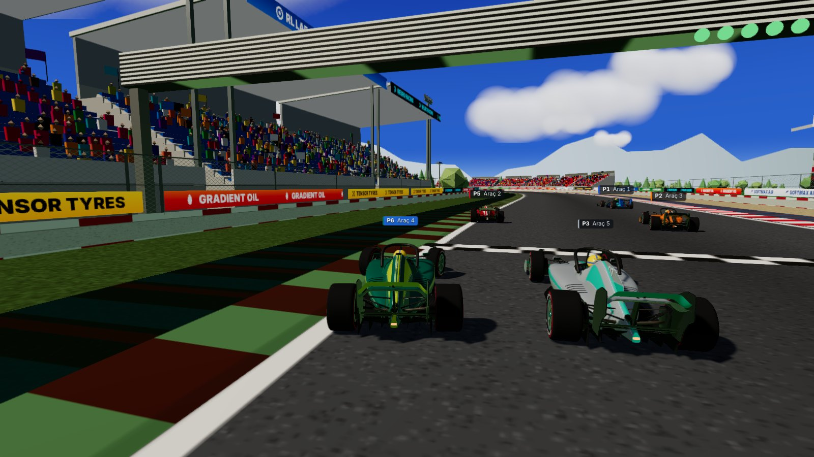
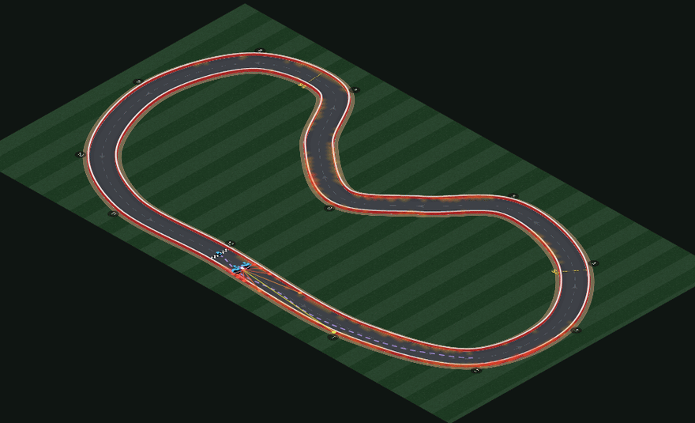
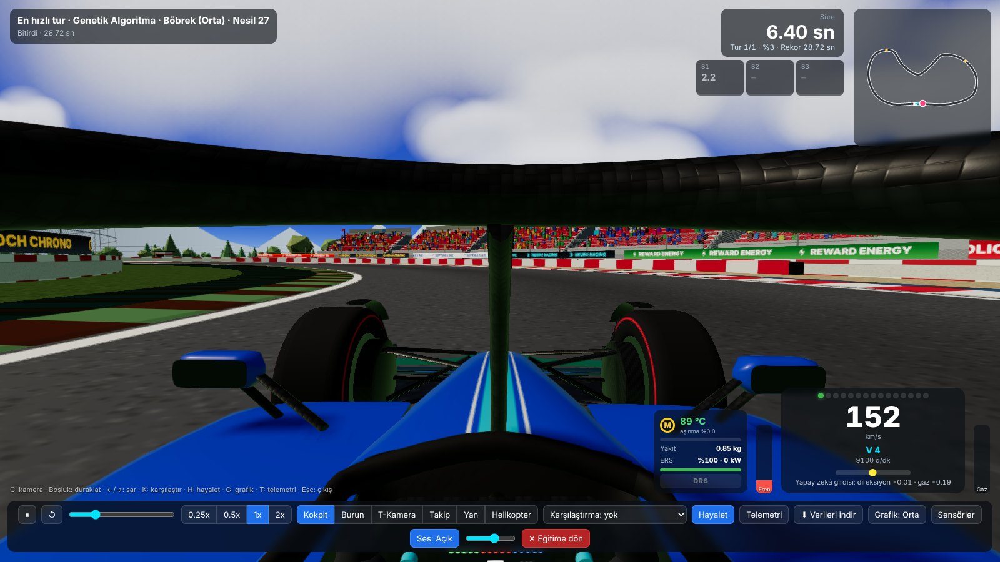
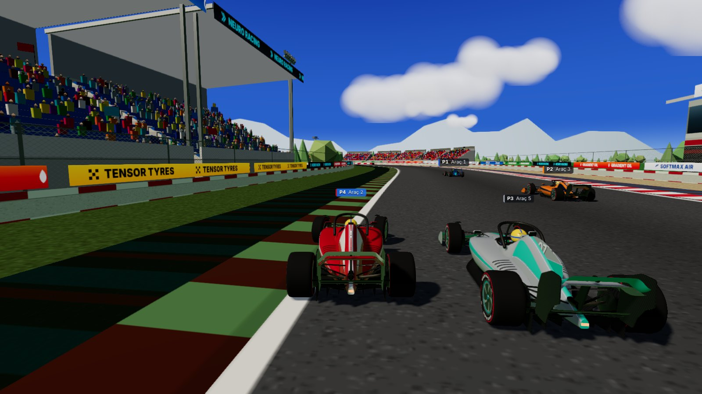
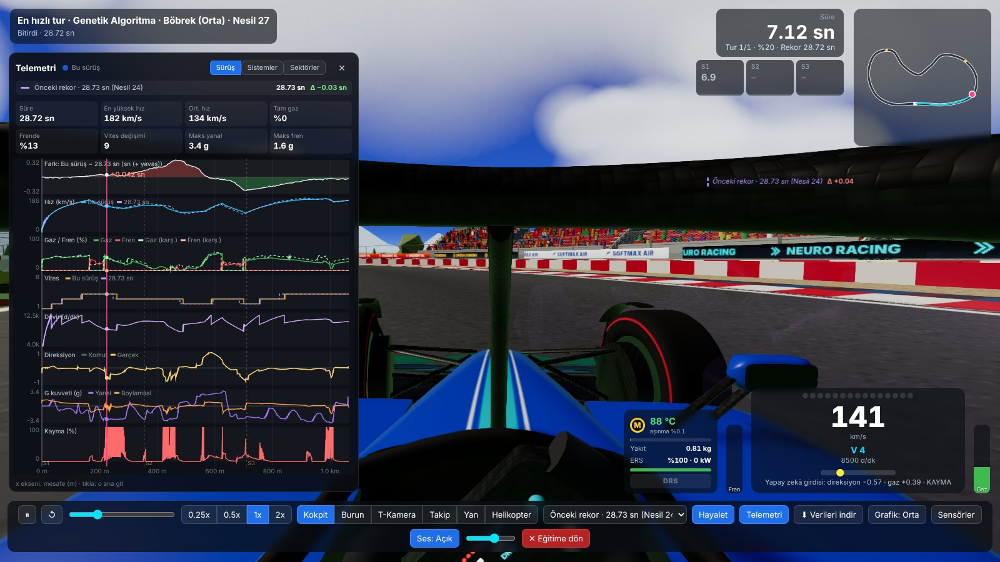
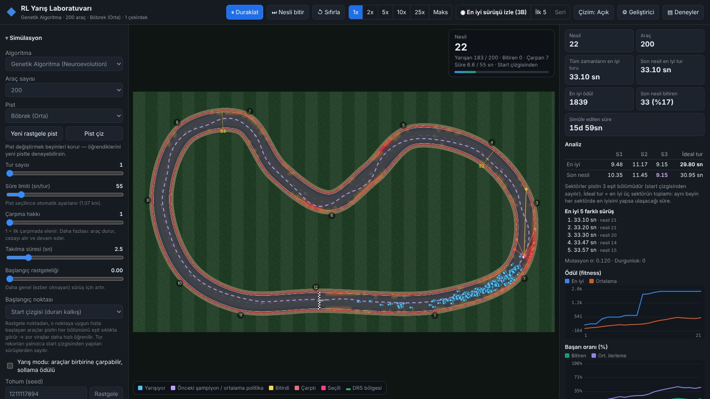
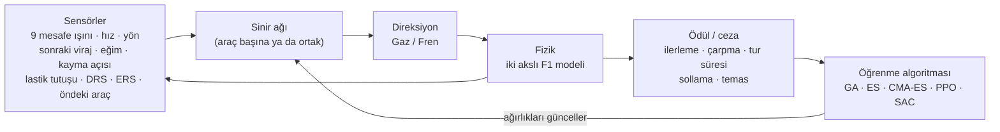
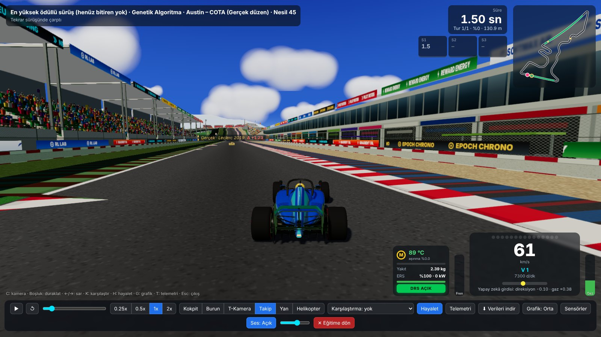

<div align="center">

# RL Yarış Laboratuvarı

### Kendi kendine yarışmayı öğrenen arabalar: yalnızca ödül ve ceza ile.

Sürüş kodu yok. Yarış çizgisi yok. Elle yazılmış kural yok.<br>
Yüzlerce sinir ağı sürücüsü rastgele çarparak başlar; nesilden nesile gerçek Formula 1 pistlerinde tur atmayı kendi başına öğrenir.

[](LICENSE)
[](package.json)
[](https://nodejs.org)
[](https://threejs.org)
[](tests)
[](#hızlı-başlangıç)

[English](README.md) · **Türkçe**



</div>

<br>

<table>
<tr>
<td width="50%" valign="top">
<br>
<b>Aynı anda 2000 araca kadar eğit.</b> Genetik algoritma, ES, CMA-ES, PPO ve SAC; tarayıcında, tüm işlemci çekirdeklerine dağıtılmış olarak.
</td>
<td width="50%" valign="top">
<br>
<b>3B'de yanında sür.</b> Eğitimi istediğin an durdur, en hızlı turu kokpitten izle: motor sesi, telemetri ve hayalet olarak gerçek bir F1 turu.
</td>
</tr>
<tr>
<td width="50%" valign="top">
<br>
<b>Birbirleriyle yarıştır.</b> Yarış modunda araçlar gridden kalkar, birbirini görür, çarpışır ve sollamadan ödül alır.
</td>
<td width="50%" valign="top">
<br>
<b>Bir mühendis gibi analiz et.</b> Hız, gaz, fren, vites, G kuvvetleri, lastik sıcaklığı, sektörler, mini sektörler ve başka bir tura karşı delta zaman.
</td>
</tr>
</table>

## Hızlı başlangıç

Yalnızca [Node.js](https://nodejs.org) 18 veya üstü gerekir. Kurulacak bir şey yok: `npm install` yok, derleme yok.

```bash
git clone https://github.com/YucelFuat/f1-reinforcement-learning.git
cd f1-reinforcement-learning
node server.js
```

Ardından **http://localhost:5180** adresini aç; eğitim hemen başlar. Port doluysa sunucu bir sonrakini dener ve adresi terminale yazar.

Windows'ta **`Baslat.cmd`** dosyasına çift tıklaman da yeter: sunucuyu başlatır ve uygulamayı kendi penceresinde açar.

### Masaüstü uygulaması

- **Baslat.cmd**: klasördeki bu dosyaya çift tıkla. Node.js'i kontrol eder, sunucuyu başlatır ve uygulamayı Edge'de (yoksa Chrome'da) adres çubuğu olmayan kendi penceresinde açar. Siyah konsol penceresini kapatmak uygulamayı durdurur. Uygulama zaten çalışıyorsa yalnızca yeni bir pencere açılır. Terminalden: `npm run app` (veya `node server.js --app`).
- **⤓ Uygulamayı yükle**: Edge/Chrome yüklemeyi önerdiğinde üst çubukta görünür. Başlat menüsü/masaüstü kısayolu ve kendi penceresiyle yüklenir. Sunucu kapalıyken de son kullanılan sürüm açılır; CPU/RAM paneli ve çok çekirdekli mod yalnızca sunucu açıkken çalışır. Önbellek geliştirmeyi etkilemez: sunucu açıkken her dosya her zaman sunucudan gelir.

> [!NOTE]
> Uygulamayı her zaman sunucu üzerinden aç (`node server.js` veya `Baslat.cmd`). `index.html` dosyasını doğrudan çift tıklayarak (`file://`) açmak çalışmaz; çok çekirdekli eğitim de sunucunun gönderdiği güvenlik başlıklarına ihtiyaç duyar.

## Eğitim ekranı

<p align="center"></p>

Pistteki araçlar, çarpma ısı haritası, önceki şampiyonun izi, sektör süreleri, ideal tur, en iyi 5 sürüş, öğrenme grafikleri ve seçili aracın canlı sinir ağı.

## Nasıl çalışır



Her araç yalnızca sensörlerinin söylediğini görür ve yalnızca topladığı ödülden öğrenir. Ona yarış çizgisi, fren noktası ya da virajın nasıl alınacağı hiç söylenmez. Ortaya çıkan sürüş tarzını algoritma kendi keşfeder.

## İçindekiler

[Algoritmalar](#algoritmalar) · [Ödül / ceza](#ödül--ceza) · [Otomatik ayar](#otomatik-ayar) · [Başlangıç noktası](#başlangıç-noktası) · [Yarış modu](#yarış-modu) · [Araç fiziği](#araç-fiziği) · [Pistler](#pistler) · [Sensörler](#aracın-algıladıkları-sinir-ağı-girdileri-25-adet) · [Analiz](#analiz-paneli) · [Deney yöneticisi](#deney-yöneticisi--deneyler-veya-e) · [Otomatik kayıt](#otomatik-kayıt-kaldığın-yerden-devam) · [3B izleme](#3b-izleme) · [Kısayollar](#kısayollar) · [Komut satırı](#komut-satırından-eğitim) · [Testler](#testler) · [Dosyalar](#dosyalar)

## Algoritmalar

| Algoritma | Tür | Nasıl öğrenir |
|---|---|---|
| **Genetik Algoritma** (varsayılan) | Popülasyon | Her aracın kendi sinir ağı var. Nesil sonunda toplam ödüle göre sıralanır. En iyiler aynen kalır (elit), diğerleri çaprazlama ve mutasyonla üretilir. |
| **Evolution Strategies (OpenAI-ES)** | Popülasyon | Ortak bir ağırlık vektörü θ var, her araç θ'nın gürültülü bir kopyasıyla sürer. θ daha çok ödül getiren gürültü yönlerine kayar. Mor araç gürültüsüz θ'dır. |
| **CMA-ES (sep-CMA)** | Popülasyon | Ortalama ve her ağırlık için ayrı bir arama genişliği tutar. Başarılı adımların yönüne göre arama genişliğini kendiliğinden büyütür ya da küçültür. |
| **PPO – ayrık** | Adım bazlı | Tüm araçlar tek bir politikayı paylaşır, ödül/ceza her adımdaki aksiyona verilir. 9 ayrık aksiyon (gaz/boş/fren × sol/düz/sağ). |
| **PPO – sürekli (Gauss)** | Adım bazlı | Direksiyon ve gaz/fren sürekli değerlerdir (ortalama + öğrenilen gürültü). Gözlem ve ödül normalizasyonu vardır, karar her 4 adımda bir verilir. Testlerde en hızlı öğrenen algoritmadır. |
| **SAC (Soft Actor-Critic)** | Adım bazlı | Geçmiş deneyimleri bir bellekte saklar ve tekrar tekrar kullanır (off-policy). İkiz Q ağı, hedef ağlar ve kendiliğinden ayarlanan entropi katsayısı kullanır. |

Adım bazlı algoritmaların gradyan güncellemeleri ayrı bir Web Worker'da (başka bir CPU çekirdeğinde) çalışır. Bu algoritmalarda **Deterministik sürüş** kutusu gürültüsüz ortalama aksiyonla sürdürür.

<details>
<summary><b>Kıyaslama</b> (böbrek biçimli test pisti, tarayıcısız, 2 çekirdekli makine)</summary>
<br>

| Algoritma | Araç | İlk biten tur | En iyi tur |
|---|---|---|---|
| Genetik Algoritma | 300 | 14–18. nesil | 26.9–28.0 sn |
| sep-CMA-ES | 300 | 8–19. nesil | 27.7–28.9 sn |
| PPO (ayrık) | 128 | 300 güncellemede yok | – |
| **PPO (sürekli)** | 128 | **7–34 sn sonra** | **25.8–25.9 sn** |
| SAC | 128 | 40–189 sn sonra | 27.2–30.6 sn |

Aralıklar üç farklı tohumdan. Kendi ölçümün için: `node tools/algo-bench.js`.

</details>

Yeni bir algoritma eklemek için [`src/algos/index.js`](src/algos/index.js) dosyasına tek bir giriş eklemek yeter; arayüz kaydırıcılarını bu girişten kendisi oluşturur.

### Çok çekirdekli simülasyon

"Simülasyon" bölümündeki **Çok çekirdekli simülasyon** kutusu açıkken GA, ES ve CMA-ES araçları işlemci çekirdeklerine bölünür. Her çekirdek kendi araçlarının sinir ağını ve fiziğini hesaplar; veriler SharedArrayBuffer ile paylaşılır.
- Varsayılan işçi sayısı en çok 8'dir (çekirdek sayısı − 1).
- Aynı tohumla tek çekirdek ve çok çekirdek birebir aynı eğitimi verir (tek başına modda).
- Sayfa `node server.js` ile açılmalıdır; sunucu gerekli güvenlik başlıklarını gönderir.
- Kendi bilgisayarındaki hızlanmayı ölçmek için: **http://localhost:5180/tools/par-test.html** → "Testi başlat".
- PPO ve SAC tek çekirdekte kalır: onların öğrenmesi zaten ayrı bir çekirdekte çalışır.

### Tohum (seed) ve tekrar üretilebilirlik

"Simülasyon" bölümündeki **Tohum** alanı rastgele sayı üretecinin başlangıç değeridir. Aynı tohum + aynı ayarlar ile **Uygula ve yeniden başlat** aynı eğitimi verir. Bu GA / ES / CMA-ES'te birebir geçerlidir. PPO/SAC'ta öğrenme ayrı bir çekirdekte çalıştığı için sonuç çok yakın olur ama birebir aynı olmaz. **↺ Sıfırla** yeni bir rastgele tohum seçer.

## Ödül / ceza

Sol panelden canlı değiştirilebilir.

- **İlerleme:** Pist boyunca ilerledikçe ödül (geri gitmek negatif).
- **Çarpma cezası:** Hızlı çarpma daha çok cezalandırılır (×0.4 – ×1.0). Spin de çarpma sayılır.
- **Takılma / geri gitme cezası:** İlerlemeyen araç elenir. Bu ceza çarpma cezasından büyük tutulur, yoksa "hiç kıpırdamamak" güvenli bir strateji hâline gelir.
- **Zaman cezası:** Her adımda küçük bir ceza.
- **Bitirme ödülü + hız bonusu:** Pisti bitiren büyük ödül alır. Süre limitinden kazandığı her saniye için ek bonus alır, yani daha hızlı bitiren daha çok ödüllendirilir.
- **Yarış modunda:** sollama ödülü (geçilen de aynı miktar ceza alır), temas cezası (arkadan vuran tam, önde olan çeyrek) ve bitiriş sırası bonusu.

**Çarpma hakkı** 1 ise araç ilk çarpmada elenir. Daha büyük bir değerde araç durur, cezayı alır ve yarışmaya devam eder.

## Otomatik ayar

Varsayılan olarak açıktır. Eğitimi izler ve 10 nesil (adım bazlı algoritmalarda 10 bölüm grubu) boyunca gelişme olmazsa:

1. Algoritma ayarlarından (mutasyon gücü, σ, öğrenme hızı, entropi…) ya da ödül/ceza değerlerinden birini değiştirir.
2. Değişikliği 6 nesil dener.
3. Skor tabanın üstüne çıktıysa değişikliği **kabul eder**, çıkmadıysa **geri alır**.

Karşılaştırma ödülden bağımsız bir skorla yapılır: en iyi %10'un ilerlemesi + bitirme oranı + tur süresi. Değişen kaydırıcılar kısa süre yanıp söner ve her karar günlükte görünür.

## Başlangıç noktası

"Simülasyon" bölümünde **Başlangıç noktası** seçilir:

- **Start çizgisi:** duran kalkış (varsayılan).
- **Pistte rastgele nokta:** araç pistin rastgele bir yerinden, o noktaya uygun bir hızla (uçan) başlar. Böylece pistin her bölümü eşit sıklıkta görülür ve zor virajlar çok daha erken öğrenilir. Popülasyon algoritmalarında bir nesildeki tüm araçlar aynı noktadan başlar, böylece karşılaştırma adil olur.
- **Karışık:** nesillerin (ya da bölümlerin) yarısı start çizgisinden, yarısı rastgele noktadan.

Tur rekorları, sektör en iyileri ve 3B tekrar yalnızca start çizgisinden yapılan sürüşlerden alınır.

## Yarış modu

"Simülasyon" bölümündeki **Yarış modu** kutusuyla açılır.

- Araçlar **seri (heat)** başına 2–12 araçlık gruplara ayrılır. Her seri gridden birlikte kalkar: sıralar 8 m arayla, sağlı sollu dizilir.
- Aynı serideki araçlar birbirini ışın sensörleriyle görür. Ayrıca "öndeki araca mesafe" ve "öndeki aracın yanal konumu" girdileri vardır.
- Araçlar çarpışabilir. Temas eden araçlar yavaşlar ve ceza alır; ağır bir arkadan çarpma arkadaki aracı yarış dışı bırakır.
- Sollamalar sayılır ve ödüllendirilir.
- **DRS "Yarış kuralı"** seçiliyse DRS yalnızca bölgeye girerken öndeki araca 1 saniyeden yakın olanlara açılır.
- 2B görünümde seçili aracın serisindeki rakipler turuncu çerçeveyle işaretlenir.
- **Seri** düğmesi (veya **B**) en hızlı kazananın serisini, tüm araçlarıyla birlikte 3B tekrar eder. GA/ES/CMA-ES'te bu tekrar eğitimdekinin aynısıdır.
- Yarış modunda yapılan rekor tur da kendi serisiyle (trafikle) birlikte tekrar edilir.

## Araç fiziği

Fizik SI birimleriyle hesaplanır. **Gerçek F1 fiziği** düğmesi 2019–2025 dönemi F1 aracına yakın değerleri uygular:

| Parametre | Değer |
|---|---|
| Kütle | 798 kg (pilot dahil) + yakıt |
| Güç | 750 kW (~1000 hp): 630 kW V6 turbo + 120 kW ERS |
| Sürükleme CdA / Yere basma ClA | 1.45 m² / 4.4 m² |
| Lastik tutuşu μ | 1.72 (ideal sıcaklıkta yeni lastik) |
| Ağırlık / aero dengesi | %45 / %42 önde |

Sonuç: son hız ~341 km/s (DRS açıkken ~360), 300 km/s'den duruş ~103 m / 3.1 sn, hızlı virajda ~5.3 g, yavaş virajda ~2.1 g.

**İki akslı model:**
- Ön ve arka aks için ayrı sürtünme çemberi.
- Boylamsal yük transferi (frende öne, gazda arkaya) ve yanal yük transferi.
- Lastik yük hassasiyeti: yük arttıkça μ düşer.
- Ön aks sınırı aşılırsa araç önden kayar (understeer). Arka aks sınırı aşılırsa burun dönmeye devam eder ve **kayma açısı (β)** büyür (oversteer). ~31°'yi aşarsa araç spin atar.
- Fren dağılımı biraz öndedir (gerçek araçlardaki gibi): sert frende araç kararlıdır, hafif frenle viraja girerken ve yavaş viraj çıkışında tam gazda arkası kayabilir.
- Ağırlık dağılımı, aero dengesi, ağırlık merkezi yüksekliği ve yük hassasiyeti kaydırıcılarla değiştirilebilir.
- Ayrıca: yere basma (hızla artan tutuş), güç ve patinaj sınırı, hava direnci, direksiyon servosu ve yokuş/iniş (eğim).

**Kolay mod** daha çok tutuş ve daha az güçle hızlı öğrenme sağlar.

### Lastik, yakıt, ERS, DRS ve strateji

"Lastik, yakıt, ERS, DRS ve strateji" bölümünde:

- **Lastik hamuru:** Yumuşak (+%2.5 tutuş, hızlı aşınır, ideal 95 °C), Orta (ideal 102 °C), Sert (−%2.5 tutuş, uzun ömür, ideal 110 °C).
- **Lastik sıcaklığı:** Lastikler yük ve kaymayla ısınır; hız ve pist sıcaklığıyla soğur. İdeal pencerenin dışında tutuş azalır. Başlangıç sıcaklığı ve pist sıcaklığı ayarlanabilir.
- **Aşınma:** Orta hamur gerçekçi hızda turda ≈ %2 aşınır. %75'ten sonra tutuş hızla düşer. Aşırı ısınma aşınmayı hızlandırır. Kısa deneyler için **aşınma hızlandırıcı** vardır (×1–×30).
- **Yakıt:** Kütleye eklenir ve gaza göre en çok 100 kg/saat akışla tükenir. "Otomatik" seçiliyse tur sayısına yetecek kadar konur. Yakıt biterse motor durur.
- **ERS:** MGU-K tam gazda 120 kW destek verir. 4 MJ batarya, turda en çok 4 MJ kullanım ve frenlemede en çok 2 MJ şarj. Kapalıyken 750 kW sabit güç.
- **DRS:** Her pistin en uzun iki düzlüğü otomatik olarak DRS bölgesi olur (2B görünümde yeşil). Açık kanat sürüklemeyi %15, arka yere basmayı %10 azaltır. Gaza basınca açılır, frende kapanır. "Bölgede serbest" (sıralama turu gibi) veya "Yarış kuralı" (öndeki araca < 1 sn) seçilebilir.
- **Pit stratejisi:** Çok turlu yarışta n. turun sonunda pite girilir: pit kaybı süresi eklenir ve seçilen yeni hamurdan lastik takılır.

## Pistler

| Pist | Uzunluk | Gerçek referans |
|---|---|---|
| Austin – COTA | 5.513 km | 1:36.169 – Leclerc, 2019 |
| İstanbul Park | 5.338 km | 1:24.770 – Montoya, 2005 |
| Monza | 5.793 km | 1:20.901 – Norris, 2025 |
| Spa-Francorchamps | 7.004 km | 1:44.701 – Pérez, 2024 |
| Silverstone | 5.891 km | 1:27.097 – Verstappen, 2020 |

Ayrıca kurgusal pistler (oval, böbrek, teknik, Grand Prix), rastgele pist üretici ve pist çizme modu vardır.

Gerçek pistlerin geometrisi bacinger/f1-circuits (MIT) verisinden alınmıştır; Austin resmi haritadan izlenmiştir. Start/finiş çizgisi, yarış yönü ve yükseklik profilleri F1 resmi zamanlama konum verisinden (TracingInsights arşivi, Apache-2.0) gelir. Yükseklik farkları formula1.com değerleriyle uyumludur (ör. Spa ≈102 m, Austin ≈31 m). Tırmanış frenlemeye yardım eder, iniş zorlaştırır.

Pistler otomatik analiz edilir: viraj numaraları (2B görünümde), DRS bölgeleri ve 3 sektör (S1/S2/S3, sarı kesikli çizgi).

<p align="center"></p>

## Aracın algıladıkları (sinir ağı girdileri, 25 adet)

- 9 mesafe ışını (−90°…+90°, 200 m). Yarış modunda diğer araçları da görür.
- Hız ve pist yönüne göre açı hatası.
- 35/90/170/280 m ilerideki pist yönü (fren noktası sezgisi).
- Pist ortasına göre yanal konum.
- Sonraki virajın tepe noktasına uzaklık ve virajın keskinliği.
- Eğim (yokuş/iniş).
- Kayma açısı β.
- Lastik tutuş durumu (sıcaklık + aşınma + hamur).
- DRS açık mı, ERS bataryası.
- Yarış modunda öndeki araca mesafe ve onun yanal konumu.

Çıktılar direksiyon ve gaz/fren (sürekli) ya da ayrık PPO'da 9 aksiyondur. Eski sürümlerde kaydedilen 15 girdili beyinler otomatik olarak yükseltilir: yeni girdilere 0 ağırlık verilir, böylece aynı şekilde sürmeye devam ederler.

## Analiz paneli

Sağ paneldeki **Analiz** bölümü şunları gösterir:
- En iyi S1/S2/S3 süreleri ve **ideal tur** (en iyi üç sektörün toplamı)
- Son neslin sektörleri (en iyiye eşit olan mor)
- En iyi 5 farklı sürüş
- Yarış modunda temas ve sollama sayıları
- Son nesildeki spin sayısı

"En iyi tur süresi" grafiğinde ideal tur da çizilir.

## Deney yöneticisi (▤ Deneyler veya E)

- **Bu deneyi kaydet**: Ad ve notla şu anki eğitimi saklar: ayarlar, pist, algoritma, tohum, araç sayısı, geçmiş, en iyi/ideal tur, en iyi beyin ve süre.
- **Liste**: Tarih, pist, algoritma, tohum, araç, en iyi tur, ideal tur, nesil ve süre. Her deneyde şu düğmeler var:
  - **Ayarları uygula:** aynı tohum ve ayarlarla yeniden başlatır.
  - **Beyni yükle**
  - **Dışa aktar** (JSON)
  - **Sil** (iki tıklama)

  **İçe aktar** ile dosyadan geri yüklenir.
- **Karşılaştır** (en çok 8 deney):
  - Grafikler: en iyi tur, bitirme oranı, en iyi ödül ve ödülden bağımsız skor (nesle göre üst üste).
  - Özet tablosu.
  - Ayar farkları tablosu: yalnızca farklı olan fizik, araç, kural, ödül ve algoritma ayarları.

## Otomatik kayıt: kaldığın yerden devam

Eğitim her 30 saniyede ve sekme kapanırken/gizlenirken tarayıcıya (IndexedDB) kaydedilir. Kaydedilenler:
- Ayarlar ve pist (çizilen/rastgele pistler dahil)
- Eğitim geçmişi ve rekor beyinler
- Algoritmanın tam durumu (popülasyon, ağırlıklar, Adam, normalizasyon)

Açılışta **"Kaldığın yerden devam et?"** kartı çıkar: **Devam et**, **Yeni başla** veya **Kaydı sil**. Kart açıkken eğitim bekler.
- Yarım kalan nesil baştan sürülür.
- GA/ES/CMA-ES, başlangıç rastgeleliği 0 iken kaldığı yerden birebir aynı devam eder.
- SAC'ın tekrar belleği kaydedilmez, bu yüzden devam ederken kısa bir ısınma yapar.

"Kayıt" bölümünde **Oturumu kaydet** ve **Oturum kaydını sil** düğmeleri var.

## 3B izleme

Eğitim duraklar ve seçilen sürüş pistte yeniden sürdürülüp 3B izlenir. **Esc** veya "Eğitime dön" ile kapatınca eğitim kaldığı yerden devam eder.

| Düğme | Ne gösterir |
|---|---|
| **◉ En iyi sürüşü izle (3B)** (V) | En hızlı tur. Yarış modunda yapıldıysa kendi serisiyle birlikte. |
| **İlk 5** (Shift+V) | En iyi 5 farklı sürüş aynı anda, birbirinin içinden geçen hayaletler gibi. |
| **Seri** (B) | Yarış modunda en iyi seri: temaslar, sollamalar, sıralama tablosu. |

GA/ES/CMA-ES'te tekrar rekor sürüşün birebir aynısıdır. PPO/SAC'ta en olası (gürültüsüz) aksiyonlarla yeniden sürülür. Henüz kimse bitiremediyse en yüksek ödüllü sürüş gösterilir.

**Araç:** Blender'da modellenmiş F1 aracı (`assets/f1car.glb`). Lastikler döner, ön tekerlekler ve direksiyon simidi döner; çoklu tekrarda her araç farklı renktedir. Model yüklenemezse kodla üretilen yedek araç kullanılır.

**Çevre:**
- Tribünler ve seyirciler, reklam köprüleri ve panoları (hepsi uydurma markalar), lastik bariyerleri, görevli kulübeleri
- Pit binası, Austin'de gözlem kulesi
- Gökyüzü, bulutlar, gölgeler, kerbler, çakıl, çitler

Arazi her zaman pistin altında kalır, araç yokuş çıkıp inerken pist hep görünür.

**Görüntü efektleri** (**G** ile Yüksek → Orta → Düşük):
- Yüksek: bloom, ortam kapatması (SSAO), hız bulanıklığı (motion blur), SMAA
- Orta: bloom, FXAA
- Düşük: efekt yok

**Kameralar** (**C**): Kokpit, Burun, T-Kamera, Takip, Yan, Helikopter.

**HUD:**
- Hız, vites, devir, gaz/fren
- DRS ışığı, ERS bataryası ve kullanımı
- Lastik hamuru, sıcaklık ve aşınma, yakıt
- Canlı sektör süreleri (mor/yeşil/sarı), tur sayacı, pit bildirimi
- Seri modunda sıralama ve aralar

**Motor sesi:** Web Audio ile gerçek zamanlı sentezlenir (devir, gaz, vites geçişleri, lastik kayması, rüzgar). **M** ile açılıp kapanır.

**Hayalet ve karşılaştırma:**
- Gerçek F1 referansı olan pistlerde (Austin, İstanbul, Monza, Spa, Silverstone) gerçek pilotun turu yarı saydam bir **hayalet araç** olarak yanında sürer (**H** ile açılır/kapanır).
- **Karşılaştırma** listesinden şunlar seçilebilir (**K** ile sıradakine geçilir):
  - Gerçek F1 referansı
  - Önceki rekor sürüşler
  - İlk 5'teki diğer sürüşler
  - CSV içe aktar…

  Seçilen sürüş de hayalet olur. Telemetri grafiklerinde üst üste çizilir ve **delta zaman grafiği** eklenir.

### Telemetri (T)

Turun tamamı mesafeye göre çizilir:
- Hız, gaz/fren, vites, devir
- Direksiyon (komut ve gerçek)
- Yanal/boylamsal G, lastik kayması, kayma açısı
- Lastik sıcaklığı ve aşınması, yakıt, ERS, DRS
- Rakım

Ayrıca:
- Sektör ve **mini sektör** tablosu: en iyi mor, karşılaştırmadan iyi yeşil, kötü sarı.
- Çok turlu tekrarda **her turun süresi ve sektörleri** (en iyi tur / son tur).
- Grafiğin üzerine gelince o noktanın değerleri görünür, tıklayınca tekrar o ana sarılır.

### Gerçek telemetri içe aktarma (CSV)

"Karşılaştırma → CSV içe aktar…" en az mesafe (m) ve hız (km/s) sütunu olan bir CSV okur.
- İsteğe bağlı sütunlar: gaz %, fren, vites, zaman.
- Ayırıcı (`,` / `;`) ve ondalık virgül kendiliğinden tanınır.
- Sütun adları İngilizce veya Türkçe olabilir: `Distance`/`mesafe_m`, `Speed`/`hiz_kmh`, `Throttle`/`gaz_yuzde`, `Brake`/`fren`, `nGear`/`vites`, `Time`.

Herhangi bir gerçek F1 turunu bu biçimde indirmek için `tools/fastf1_export.py` vardır. Kendi bilgisayarında, bir kez `py -m pip install fastf1` kurulumundan sonra çalışır:

```
py tools\fastf1_export.py --yil 2024 --etkinlik Monza --oturum Q --surucu LEC
```

Ayrıntılar dosyanın başındadır.

### Verileri indir (D)

Tek bir ZIP dosyası:

| Dosya | İçerik |
|---|---|
| `telemetri.csv`, `telemetri_excel_tr.csv` | Her 1/60 sn için tüm kanallar (pandas/R için ve Türkçe Excel için) |
| `sektorler.csv` | Sektör ve mini sektör süreleri (karşılaştırmayla) |
| `karsilastirma_delta.csv` | Karşılaştırma açıksa mesafeye göre iki sürüş ve delta |
| `araclar_ozet.csv`, `araclar/*.csv`, `seri_olaylari.csv` | Çoklu tekrarda tüm araçlar ve seri olayları |
| `egitim_gecmisi*.csv` | Her nesil/güncellemenin istatistikleri |
| `ozet.json` | Tur özeti, pist, algoritma, fizik, araç sistemleri, kurallar, ödül/ceza, tohum |
| `otomatik_ayar_gunlugu.txt` | Otomatik ayarın tüm kararları |
| `beyin.json` | Bu sürüşü yapan sinir ağı ("JSON yükle" ile geri yüklenebilir) |
| `telemetri_grafikleri.png`, `pist_haritasi.png`, `3b_goruntu.png` | Grafikler, sürülen çizgi ve o anki 3B görüntü |
| `OKU_BENI.txt` | Dosya ve sütun açıklamaları |

## Kısayollar

**Eğitim ekranı:**

| Tuş | İşlev |
|---|---|
| Boşluk | Başlat / duraklat |
| 1–6 | Hız: 1x, 2x, 5x, 10x, 25x, Maks |
| F3 veya ` | Geliştirici modu |
| I | İzometrik görünüm |
| R | Sensör ışınları |
| F | Lideri takip et |
| H | Çarpma ısı haritası |
| N | Nesli bitir |
| V / Shift+V / B | En iyi sürüş / İlk 5 / Seri (3B) |
| E | Deney yöneticisi |

Fare tekerleği yakınlaştırır, sürükleme kaydırır, bir araca tıklamak onu seçer (beynini ve lastik/yakıt/ERS durumunu sağ panelde canlı görürsün). Boş bir yere tıklamak otomatik lider seçimine döner.

**3B ekranı:**

| Tuş | İşlev |
|---|---|
| C | Kamera |
| Boşluk / R | Oynat-duraklat / Başa sar |
| ← / → | ±2 sn sar |
| K | Sıradaki karşılaştırma |
| H | Hayaletler |
| L | Etiketler |
| 1–9, [ / ] | Odak aracı (çoklu tekrarda) |
| T | Telemetri |
| G | Grafik kalitesi |
| D | Verileri indir |
| S | Sensör ışınları |
| M | Ses |
| Esc | Çıkış |

## Geliştirici modu (F3)

- FPS, kare süresi, kare başına simülasyon ve çizim maliyeti, ana iş parçacığı yükü
- Saniyedeki simülasyon adımı (gerçek zamanın kaç katı), araç-adım/sn
- Simülasyon işçileri ve doluluk (çok çekirdekte)
- Uzun görevler, JS belleği, öğrenme güncellemesi süresi

`node server.js` ile açıldığında **gerçek sistem CPU kullanımı (çekirdek bazında) ve RAM** de gösterilir.

## Diğer

- **Pist çiz:** Kontrol noktalarına tıklayarak kendi pistini oluşturursun. Pist tarayıcıda saklanır.
- **Pist değiştirmek beyinleri korur.** Bir pistte öğrenen sürücüyü başka bir pistte deneyebilirsin. "Başlangıç rastgeleliği" ve rastgele başlangıç noktası ezberlemeyi azaltır.
- **Kayıt:** Tüm zamanların en iyi beyni tarayıcıya kaydedilebilir veya JSON olarak indirilip yüklenebilir. Yüklenen beyin uygun algoritmaya kendiliğinden geçer.
- **Çizim: Kapalı** seçeneği ekrana çizimi durdurur ve tüm işlemciyi eğitime verir.

## Komut satırından eğitim

```
node tools/headless.js --algo ppoc --cars 128 --track kidney --updates 300
node tools/headless.js --algo ga --cars 300 --track austin --gens 200 --spawn mixed --out beyin.json
```

Seçenekler:
- `--algo` ga | es | cmaes | ppo | ppoc | sac
- `--track` oval | kidney | technical | gp | austin | istanbul | monza | spa | silverstone
- `--spawn` start | mixed | random
- `--mode` solo | race, `--heat 6`
- `--compound` soft | medium | hard, `--tyre 0/1`, `--wear 0/1`, `--ers 0/1`, `--drs off/zones/race`
- `--pit n`, `--laps n`, `--seed n`, `--physics easy`

Oluşan `beyin.json` dosyasını uygulamadaki "JSON yükle" ile yükleyebilirsin. Algoritmaları karşılaştırmak için: `node tools/algo-bench.js`.

## Testler

`npm test` tüm testleri ~15 saniyede çalıştırır. Yavaş testi atlamak için `npm run test:fast`, tek dosya için `node tests/run.js physics`.

Kapsam:
- **Fizik:** son hız, DRS, fren mesafesi; lastik, yakıt ve ERS; kayma/spin; araç-araç teması; bitiş ve tur süresi; başlangıç modları; aynı tohum = aynı sonuç.
- **Pistler ve beyinler:** pist analizi, eski beyin yükseltme, tekrarın eğitimle aynı çıkması, GA öğrenme testi.
- **Kayıt ve dosyalar:** tüm algoritmalar için kaydet/yükle, deney karşılaştırma, ZIP dosyası ve sunucu başlıkları.

Algoritma durumu ve işçi testleri: `node tools/algo-state-test.js`, `node tools/algo-worker-test.js`.

## Dosyalar

| Dosya | İçerik |
|---|---|
| `server.js` | Bağımlılıksız sunucu: dosyalar, CPU/RAM API'si, COOP/COEP başlıkları, `--app` |
| `Baslat.cmd`, `manifest.webmanifest`, `sw.js`, `icons/` | Masaüstü başlatıcı ve yüklenebilir uygulama |
| `src/config.js` | Varsayılan ayarlar, fizik önayarları, lastik hamurları, gözlem düzeni |
| `src/sim.js` | Araç fiziği, sensörler, ödül/ceza, yarış modu |
| `src/track.js`, `src/tracks/` | Pistler, viraj/DRS/sektör analizi; gerçek pistler ve referans telemetri |
| `src/trainer.js`, `src/parallel/` | Eğitim döngüsü; çok çekirdekli eğitim |
| `src/algos/` | GA, ES, CMA-ES, PPO (ayrık/sürekli), SAC ve kayıt dosyası (`index.js`) |
| `src/brain.js`, `src/nn.js` | Beyin sürüm uyumluluğu; sinir ağı, geri yayılım, Adam |
| `src/replay.js` | Beyinleri yeniden sürdürme (tek / çoklu / seri) |
| `src/cockpit.js`, `src/replay-car.js`, `src/f1car.js`, `src/scenery.js`, `src/postfx.js` | 3B tekrar, araç modelleri, sahne, görüntü efektleri |
| `src/telemetry.js`, `src/replay-analysis.js`, `src/exporter.js` | Telemetri grafikleri, sektör/delta analizi, ZIP dışa aktarma |
| `src/persist.js`, `src/experiments*.js`, `src/pwa.js` | Otomatik kayıt, deney yöneticisi, uygulama yükleme |
| `src/autotune.js` | Otomatik ayar |
| `src/main.js`, `src/render.js`, `src/charts.js`, `src/nnviz.js`, `src/devstats.js` | Arayüz, 2B çizim, grafikler, ağ görselleştirme, geliştirici paneli |
| `assets/f1car.glb` | Blender'da modellenmiş F1 aracı |
| `tests/`, `tools/` | Testler, komut satırı eğitimi, ölçüm araçları, FastF1 dışa aktarıcı |
| `vendor/` | Three.js r160 (MIT) ve eklentileri |

## Kaynaklar ve teşekkür

- 3B çizim: [three.js](https://threejs.org) (MIT).
- Pist geometrileri: [bacinger/f1-circuits](https://github.com/bacinger/f1-circuits) (MIT).
- Yükseklik profilleri ve gerçek referans turlar: [TracingInsights](https://github.com/TracingInsights) F1 telemetri arşivi (Apache-2.0). Kaynağı F1 resmi zamanlama verisidir.
- Ayrıntılar: [THIRD_PARTY_NOTICES.md](THIRD_PARTY_NOTICES.md).

Bu bağımsız bir hobi projesidir. Formula 1, FIA ya da herhangi bir takım veya pilotla bağlantısı yoktur. 3B sahnedeki sponsor adları uydurmadır.

## Lisans

[MIT](LICENSE)
